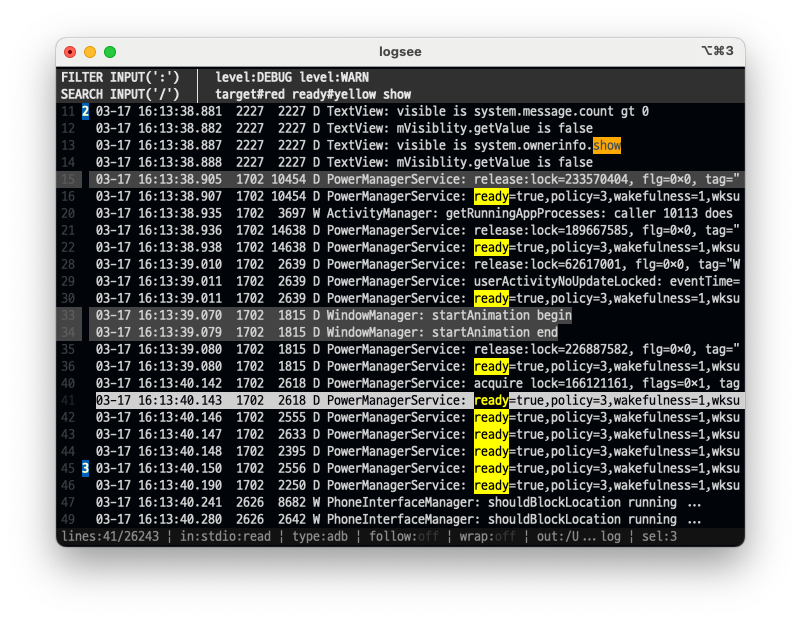

# logsee

로그 파일과 파이프 입력을 터미널에서 탐색하는 TUI 로그 뷰어입니다. 필터로 필요한 줄을 추리고, 검색어를 색상으로 강조하며, 선택한 로그를 클립보드로 복사할 수 있습니다.



- 파일 열기와 표준 입력 저장, 추가되는 로그 따라가기
- 문자열·제외 조건·키/값·로그 레벨 필터와 OR 조합
- 여러 검색어의 하이라이트, 검색어별 색상, 다음·이전 결과 이동
- 줄 단위 선택·복사, 최대 9개 북마크
- 긴 줄의 줄바꿈·가로 스크롤, 터미널 크기 변경 반영
- `plain`·`adb`·`kernel` 타입 판별, 필터·검색 히스토리 복원

## 설치와 빠른 시작

Go 1.22 이상, `make`, 키 입력이 가능한 터미널이 필요합니다. 저장소 루트에서 빌드합니다.

```sh
make build
./bin/logsee --help
./bin/logsee /path/to/app.log
```

`logsee` 명령으로 사용하려면 로컬 경로에 설치합니다.

```sh
make publish-local
# ~/.local/bin/logsee에 설치됩니다. ~/.local/bin을 PATH에 추가하세요.
```

처음 실행한 뒤에는 다음 순서로 사용할 수 있습니다.

1. `:`를 누르고 `timeout -retry`를 입력한 뒤 `Enter`로 필터를 적용합니다.
2. `/`를 누르고 `error#red`를 입력한 뒤 `Enter`로 검색어를 강조합니다.
3. `n` / `p`로 다음·이전 검색 결과로 이동합니다.
4. `Space`로 복사할 줄을 선택하고 `c`로 복사합니다. 선택하지 않았다면 현재 줄을 복사합니다.
5. `G`로 마지막 줄을 따라가고, `Ctrl+C`로 종료합니다. 전체 키 안내는 `F1` 또는 `?`로 엽니다.

클립보드 복사에는 macOS의 `pbcopy` 또는 Linux의 `xclip`이 필요합니다. Linux에서는 `xclip -selection clipboard`를 실행할 수 있는 환경에서 사용합니다.

## 입력과 CLI 옵션

```sh
# 기존 파일 열기
logsee /var/log/syslog

# 파이프 입력 보기: 현재 디렉터리에 로그 파일을 생성합니다.
some-command 2>&1 | logsee

# 파이프 입력의 저장 경로 지정
some-command 2>&1 | logsee --out session.log

# Android logcat 입력
adb logcat -v threadtime | logsee --log-type adb

# 타입과 설정 파일 지정: 옵션은 입력 파일보다 앞에 둡니다.
logsee --log-type kernel --config ./config.toml kernel.log
```

| 입력 | 동작 |
| --- | --- |
| 인자 없음 또는 `-` | 표준 입력을 파일에 저장하고 그 파일을 읽어 표시 |
| 파일 경로 1개 | 원본 파일을 직접 읽어 표시 |

표준 입력의 기본 저장 경로는 `./logsee-YYYYMMDD-HHMMSS.log`입니다. `--out`으로 지정한 파일이 이미 있으면 끝에 이어 씁니다. 저장 시 원래 줄바꿈과 개행 없는 마지막 줄을 보존하며, 파일 기록과 동기화가 완료된 내용부터 화면에 표시합니다.

파일 입력은 원본을 수정하지 않습니다. 파일에 추가되는 내용도 표시하며, 파일 교체나 크기 감소를 감지하면 선택과 북마크를 초기화합니다. 로그 전체를 한꺼번에 메모리에 적재하지 않고 필요한 구간을 읽습니다.

```text
logsee [options] [input-file|-]
```

| 옵션 | 설명 |
| --- | --- |
| `--help`, `-h` | 사용법 출력 후 종료 |
| `--config <path>` | TOML 설정 파일 지정 |
| `--log-type <auto\|plain\|adb\|kernel>` | 로그 타입 지정. 기본값은 설정 파일 또는 `auto` |
| `--out <path>` | 표준 입력을 저장할 파일 경로 |
| `--ignore-case` | 필터의 문자열·태그 비교에서 대소문자 무시 |
| `--version` | 버전 출력 후 종료 |

`--ignore-case`는 검색에 적용되지 않습니다. 검색은 항상 대소문자를 구분합니다.

## 화면과 기본 조작

화면은 필터 입력창, 검색 입력창, 로그 목록, 상태바로 구성됩니다.

```text
필터 입력창
검색 입력창
로그 목록: 원본 줄 번호 · 북마크 번호 · 로그 본문
상태바: lines · in · type · follow · wrap · out · bm · sel · msg
```

줄 번호는 원본 파일 기준으로 1부터 시작하며 필터를 적용해도 유지됩니다. `lines`는 현재 원본 줄 번호와 원본 전체 줄 수를 표시합니다. 줄 수를 계산하는 동안 전체 줄 수는 `?`로 표시됩니다.

상태바에서 입력 모드와 읽기 상태(`in`), 로그 타입(`type`), 따라가기(`follow`), 줄바꿈(`wrap`), 표준 입력 저장 경로(`out`), 북마크 번호(`bm`)를 확인할 수 있습니다. 선택이 있으면 `sel`, 복사 결과나 오류가 있으면 `msg`가 추가됩니다.

### 목록 이동과 따라가기

| 키 | 동작 |
| --- | --- |
| `j` / `↓`, `k` / `↑` | 아래 / 위로 이동 |
| `PageDown` / `Ctrl+F` | 화면 아래 끝으로 이동하고, 아래 끝에서는 다음 페이지로 이동 |
| `PageUp` / `Ctrl+B` | 화면 위 끝으로 이동하고, 위 끝에서는 이전 페이지로 이동 |
| `Home` | 필터를 통과한 목록의 처음으로 이동 |
| `End` / `G` | 목록의 마지막 줄로 이동하고 follow 켜기 |
| `n` / `Ctrl+N` | 다음 검색 결과로 이동 |
| `p` / `Ctrl+P` | 이전 검색 결과로 이동 |
| `m` | 현재 줄 북마크 추가·해제 |
| `1`–`9` | 현재 읽어 둔 목록 범위의 해당 북마크로 이동 |
| `Ctrl+C` | 어느 화면에서든 종료 |

처음에는 follow가 꺼져 있습니다. `G` 또는 `End`를 누르거나 일반 이동으로 마지막 줄에 도달하면 켜지고, 새 로그가 추가될 때 마지막 줄을 따라갑니다. 마지막 줄을 벗어나면 꺼집니다. 검색 결과나 북마크로 이동했을 때는 마지막 줄이어도 follow를 끕니다.

### 줄바꿈과 가로 스크롤

기본값은 `wrap:off`입니다. `w`로 줄바꿈을 전환합니다.

- 줄바꿈을 끄면 `h` / `l` 또는 `←` / `→`로 본문을 좌우로 스크롤합니다. 줄 번호와 북마크 표시는 고정됩니다.
- 줄바꿈을 켜면 긴 로그 한 줄을 여러 화면 행으로 표시합니다. 화면보다 긴 줄도 위·아래 및 페이지 이동으로 나머지 내용을 볼 수 있습니다.
- 한글·이모지 등의 터미널 표시 폭을 반영하며, 터미널 크기가 바뀌면 화면을 다시 배치합니다.

## 필터

목록에서 `:`를 눌러 편집하고 `Enter`로 적용합니다. 문법 오류가 있으면 기존 필터를 유지하고 입력창에 오류를 표시합니다. `Esc`는 편집만 취소하며, 필터를 해제하려면 입력 내용을 비운 뒤 `Enter`를 누릅니다.

필터는 표시할 줄을 결정합니다. 적용된 검색어는 유지되며 검색 결과 이동도 필터를 통과한 줄 안에서 동작합니다. 조건은 정규식이 아닌 문자열과 태그로 작성합니다.

| 입력 예 | 의미 |
| --- | --- |
| `timeout` 또는 `+timeout` | `timeout`을 포함한 줄 |
| `timeout retry` | 두 문자열을 모두 포함한 줄 |
| `timeout -retry` | `timeout`을 포함하되 `retry`는 없는 줄 |
| `"connection failed"` | 공백을 포함한 문자열 검색 |
| `service:prod` | `service=prod` 또는 `service:prod` 형태의 키/값 조건 |
| `-service:prod` | 해당 키/값 조건에 맞는 줄 제외 |
| `level:ERROR level:WARN` | ERROR 또는 WARN 레벨 |
| `error \| timeout` | 어느 한쪽 조건에 맞는 줄 |
| `service:prod error \| service:dev warn` | 조건 묶음 두 개를 OR로 연결 |

공백과 탭으로 조건을 나눕니다. 서로 다른 조건은 AND, 같은 태그의 여러 포함 값은 OR로 결합합니다. 같은 태그의 제외 값은 하나라도 일치하면 제외합니다. `|`는 공백으로 구분하며 빈 조건 묶음과 `||`는 허용하지 않습니다.

일반 태그는 값 전체를 비교합니다. 키와 `:` 또는 `=` 사이, 구분자와 값 사이의 공백을 허용하며, 값은 다음 공백이나 쉼표 앞까지 읽습니다. 예를 들어 `over_speed: false` 로그는 `over_speed:false`로 필터링할 수 있습니다.

### 로그 레벨 조건

`level`은 일반 키/값 대신 로그 타입별 규칙을 사용하는 예약 태그입니다.

| 타입 | 추출 규칙과 예 |
| --- | --- |
| `adb` | threadtime 및 `E/Tag: ...` 형식의 V/D/I/W/E/F를 VERBOSE/DEBUG/INFO/WARN/ERROR/FATAL로 변환 |
| `kernel` | `[ 1.234] ERROR: ...`처럼 타임스탬프 뒤의 대문자 레벨 이름 추출 |
| `plain` | 레벨 추출 없음 |

`kernel`로 판별되더라도 레벨 표기가 없는 줄은 `level:ERROR` 같은 포함 조건에 맞지 않습니다. 기본 비교는 대소문자를 구분하며, `--ignore-case`를 사용하면 필터 비교에서 무시합니다.

## 검색과 하이라이트

목록에서 `/`를 누르고 검색어를 입력한 뒤 `Enter`로 적용합니다. 검색은 목록을 줄이지 않고 일치하는 부분을 강조합니다. `Esc`는 편집을 취소하고 적용된 검색어를 유지합니다.

- 공백·탭으로 검색어를 나누고, 공백을 포함한 문구는 큰따옴표로 감쌉니다.
- 검색어 중 하나라도 부분 일치하면 검색 결과입니다. 정규식은 사용하지 않습니다.
- `n` / `p` 또는 `Ctrl+N` / `Ctrl+P`로 현재 줄 이후·이전 결과로 이동합니다.
- 끝에서 처음으로 순환하지 않으며, 결과가 없으면 상태바에 `no match`를 표시합니다.

검색어 뒤에 `#색상`을 붙이면 강조색을 지정할 수 있습니다.

```text
error#red timeout#green "connection failed"#yellow
```

지원 색상은 `red`, `green`, `blue`, `yellow`, `cyan`, `magenta`, `white`, `black`, `orange`, `purple`, `pink`입니다. 생략하면 기본 강조색을 사용합니다. 서로 다른 검색어가 겹치는 부분은 먼저 입력한 검색어의 색상을 사용합니다.

## 입력 편집과 히스토리

필터·검색 입력창에서는 `←` / `→`로 커서를 옮기고 `Backspace`로 문자를 지울 수 있습니다. 검색 입력창의 `↑`는 필터 입력창으로 이동합니다.

두 입력창 모두 `↓`로 해당 히스토리를 엽니다.

| 키 | 히스토리에서의 동작 |
| --- | --- |
| `j` / `k`, `↑` / `↓` | 항목 이동 |
| `PageUp` / `PageDown`, `Home` / `End` | 페이지 또는 처음·끝으로 이동 |
| `Enter` | 선택한 문자열을 입력창에 채움. 다시 `Enter`를 눌러 적용 |
| `Esc` / `F1` | 히스토리 닫기 |

필터와 검색은 각각 최근 10개의 서로 다른 문자열을 `$HOME/.local/logsee/input_history.json`에 저장합니다. 다음 실행 시 마지막으로 적용한 값을 복원합니다. 빈 문자열을 적용하면 다음 실행 시에도 해당 입력을 비우지만 이전 히스토리 항목은 남습니다.

## 북마크와 선택 복사

### 북마크

`m`으로 현재 줄에 북마크를 추가하거나 해제합니다. 최대 9개이며, 비어 있는 가장 작은 번호를 사용합니다. 해제해도 다른 북마크의 번호는 바뀌지 않습니다.

`1`–`9`로 이동할 수 있지만, 이동 대상은 현재 읽어 둔 목록 범위로 제한됩니다. 필터에 가려지거나 읽어 둔 범위를 벗어난 북마크로는 이동하지 않습니다. 북마크는 현재 실행 중에만 유지됩니다.

### 줄 선택과 복사

| 키 | 동작 |
| --- | --- |
| `Shift+↑` / `Shift+↓` | 시작 줄부터 커서까지 구간 선택 |
| `Shift+Home` / `Shift+End` | 시작 줄부터 목록 처음·끝까지 선택 |
| `Space` | 현재 줄 선택·해제 |
| `c` | 선택한 줄을 클립보드로 복사. 선택이 없으면 현재 줄 복사 |

Shift로 선택한 줄은 선택 집합에 누적됩니다. 일반 이동은 활성 구간 표시만 해제하며 이미 선택한 줄은 유지합니다. 활성 구간에서 `Space`를 누르면 선택을 유지한 채 현재 줄만 토글합니다.

복사할 때는 화면 밖의 선택도 포함하여 원본 줄 번호 순서로 정렬하고, 중복 없이 로그 본문을 줄바꿈으로 연결합니다. 줄 번호·북마크·화면 하이라이트는 복사하지 않습니다. 성공하면 상태바에 `1 line copied` 또는 `N lines copied`가 표시됩니다.

`:` 또는 `/`로 입력창에 들어가면 선택을 모두 해제합니다. 필터를 성공적으로 적용할 때도 선택을 초기화합니다.

## 도움말과 Esc

목록에서는 `?`, 입력창을 포함한 일반 화면에서는 `F1`로 도움말을 엽니다. 도움말이 열려 있는 동안 `j` / `k`, 방향키, 페이지 키, `Home` / `End`로 도움말을 스크롤하고 `Esc` / `F1` / `?`로 닫습니다. 히스토리가 열려 있을 때의 `F1`은 히스토리를 닫습니다.

`Esc`는 현재 위치에 따라 동작합니다.

| 위치 | 동작 |
| --- | --- |
| 도움말 또는 히스토리 | 열린 팝업만 닫기 |
| 필터·검색 입력창 | 편집 취소 후 목록으로 복귀. 적용된 조건 유지 |
| 로그 목록 | 최근 활성화한 선택 또는 검색 상태부터 하나씩 해제 |

목록에서 `Esc`를 눌러도 적용된 필터는 유지됩니다. 필터는 입력창을 비운 뒤 `Enter`로 해제합니다.

## 로그 타입과 설정

지원 타입은 `auto`, `plain`, `adb`, `kernel`입니다. 기본값은 `auto`이며, `--log-type`으로 지정하면 설정 파일보다 우선합니다.

자동 판별은 처음의 비어 있지 않은 로그 최대 `probe_lines`줄과 타입별 정규식을 비교합니다. 일치 점수가 가장 높은 타입을 선택하고, 일치하지 않거나 점수가 같으면 `plain`으로 처리합니다. 내장 패턴은 logcat의 threadtime·레거시 형식과 커널 타임스탬프·syslog의 `kernel:` 형식을 인식합니다.

표준 입력은 완성된 샘플 줄이 충분히 모이거나 입력이 끝날 때까지 `type:auto~`로 표시합니다. 타입이 확정되면 입력해 둔 레벨 필터도 다시 적용합니다. 확정한 타입은 실행 중에 자동으로 변경하지 않습니다.

기본 설정 경로는 `$HOME/.local/logsee/config.toml`입니다. 기본 경로에 파일이 없으면 내장값으로 실행하며, 별도 파일은 `--config`로 지정합니다.

```toml
[log_type]
default = "auto"
probe_lines = 200

[log_type.patterns]
plain = []
adb = [
  '''^\d{2}-\d{2}\s+\d{2}:\d{2}:\d{2}\.\d+\s+\d+\s+\d+\s+[VDIWEF]\s+''',
]
kernel = [
  '''^\[[\s\d.]+\]\s+''',
]
```

| 항목 | 설명 |
| --- | --- |
| `log_type.default` | 기본 모드. `auto`, `plain`, `adb`, `kernel` 중 하나 |
| `log_type.probe_lines` | 자동 판별 샘플 줄 수. 1 이상, 기본 200 |
| `log_type.patterns.adb` | adb 판별 정규식 목록 |
| `log_type.patterns.kernel` | kernel 판별 정규식 목록 |

위 예시처럼 패턴을 지정하면 해당 타입의 내장 목록을 대체합니다. 내장 패턴을 그대로 쓰려면 `[log_type.patterns]` 부분을 생략합니다. 패턴 설정은 타입 판별에만 사용되며 레벨 추출 규칙을 바꾸지는 않습니다. `plain`은 동률·무매칭 시의 기본 타입이며, `plain` 패턴은 판별 점수에 사용하지 않습니다.

잘못된 TOML, 지원하지 않는 타입, 유효하지 않은 샘플 줄 수나 정규식은 설정 오류로 처리합니다.

## 개발

Go와 Bubble Tea 기반으로 구현되어 있습니다.

| 경로 | 역할 |
| --- | --- |
| [cmd/logsee](cmd/logsee/) | CLI 실행 진입점 |
| [internal/adapter](internal/adapter/) | TUI, 앱 실행, 파일·설정·클립보드 연동 |
| [internal/usecase](internal/usecase/) | 입력, 탐색, 필터, 검색, 선택 등 동작 |
| [internal/port](internal/port/) | 파일 읽기·입력·클립보드 인터페이스 |
| [testdata](testdata/) | 테스트 데이터와 터미널 테스트 도구 |

```sh
make help                       # 전체 target 안내
make test-once                  # 캐시 없이 전체 테스트
make lint                       # 포맷 검사와 go vet
make verify                     # 테스트, 포맷, vet, 빌드, race 검사
make run ARGS="/path/to/app.log" # 소스에서 실행
```

`make build`는 `VERSION` 값을 바이너리에 포함합니다. 현재 값은 `make version`으로 확인할 수 있고, `make version-up VERSION_PART=patch`로 올릴 수 있습니다. `VERSION_PART`는 `major`, `minor`, `patch`를 지원하며 생략하면 `minor`입니다.

## 라이선스

[MIT License](LICENSE)
